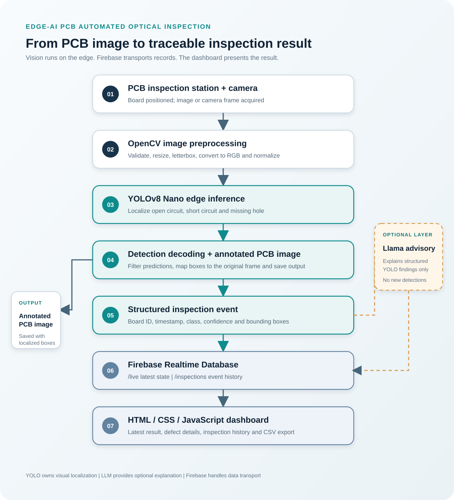
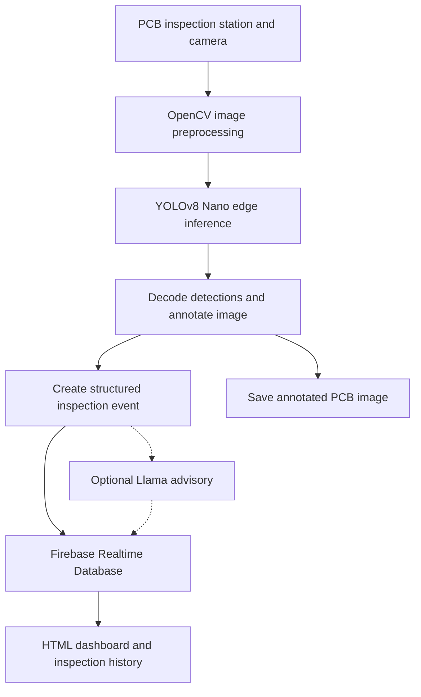

# Edge-AI PCB Automated Optical Inspection (AOI)

**A built edge-AI inspection workflow that combines PCB image acquisition, YOLO-based defect localization, Raspberry Pi edge processing, Firebase data exchange and a live operator dashboard.**

We built this system to inspect printed circuit boards at an inspection station and identify three visual defect categories: **open circuit, short circuit and missing hole**. The workflow connects the physical inspection stage with computer vision, structured inspection records and an operator-facing monitoring interface. Processing is performed at the edge, while Firebase carries inspection information to the dashboard.

The system brings together the following parts:

- A camera-based PCB image acquisition path connected to the inspection station.
- OpenCV preprocessing and a YOLOv8 Nano object-detection pipeline.
- Raspberry Pi 5 edge-inference software, including image and camera input.
- Structured inspection records with class, confidence, bounding-box coordinates, board ID and timestamp.
- An optional Llama-family operator-advisory interface that works from structured detector findings.
- Firebase Realtime Database for inspection history and latest-result updates.
- A browser-based dashboard for viewing results, defect information and inspection history.
- Reference-board comparison utilities for additional visual verification.

This repository brings the inspection pipeline, edge software, dataset utilities, dashboard, data contract and deployment documentation into one project.

**Evaluator resources:** [Technical project report](docs/PROJECT_REPORT.md) | [System architecture diagram](docs/inspection_workflow.svg) | [Demonstration video upload folder](demo_video/)

---

## 1. Problem statement and project objectives

Visual PCB inspection requires identifying small defects in conductive paths and board features. Manual inspection can be time-consuming, difficult to standardize and challenging to scale across repeated boards. Our system uses computer vision to locate selected defect patterns and creates a traceable record for each inspection.

The project objectives are to:

1. Capture PCB images at the inspection station.
2. Detect and localize open circuits, short circuits and missing holes.
3. Run image preprocessing and model inference on edge hardware.
4. Convert detections into structured, timestamped inspection events.
5. Provide optional text-based operator guidance without changing detector output.
6. Publish the latest result and inspection history to Firebase.
7. Display current results and historical records in a web dashboard.
8. evaluate detection quality, edge-device performance and inspection-system behaviour using repeatable tests.

## 2. End-to-end working flow

The following sequence describes how an inspection moves through the system, from PCB positioning to the dashboard.

### Stage 1 — PCB positioning and image acquisition

A PCB is brought to the inspection position. The camera captures the board image for analysis. The edge application accepts an image from a file, a USB/UVC camera or a Raspberry Pi CSI camera through Picamera2. The captured frame is passed to the image-processing stage.

### Stage 2 — Image preprocessing

OpenCV prepares the captured frame for the detector. The image is resized while preserving its aspect ratio, padded to the model input size, converted from BGR to RGB and normalized. The current Pi inference application uses a 640 × 640 model input.

### Stage 3 — YOLO-based defect detection

The preprocessed image is passed to the YOLOv8 Nano detector. The model predicts candidate bounding boxes and class scores for the three target defect categories:

| Defect class | What the system looks for |
|---|---|
| **Open circuit** | A visible discontinuity or break in a conductive track |
| **Short circuit** | An unintended conductive bridge between separate tracks |
| **Missing hole** | A hole that is absent or visibly defective at an expected PCB location |

The output is decoded into class identifiers, class names, confidence scores and bounding-box coordinates. Non-maximum suppression removes overlapping duplicate predictions. Coordinates are mapped back to the original image so that the result can be drawn at the correct location.

### Stage 4 — Inspection record generation

After inference, the application creates a structured inspection event. The event contains the board identifier, timestamp, input source, model information, inference latency and detected defects. Each detection includes its class, confidence and bounding box.

The application also creates an annotated PCB image with the detected regions marked. The JSON event and annotated image provide traceable evidence for the inspection.

The current result semantics distinguish a board requiring review from an image in which no configured target defect was detected. **No target defect detected** is not treated as proof that a PCB is completely defect-free.

### Stage 5 — Optional operator advisory

The advisory component receives the structured detector findings rather than the original PCB image. It passes the board ID, detected class, confidence, coordinates and approved inspection procedures to the Llama-family layer to generate a short explanation or a suggested manual verification step.

The advisory is kept separate from the vision model. It does not create detections, change class labels, suppress predictions or independently make the inspection decision. YOLO remains responsible for visual localization.

### Stage 6 — Firebase publication

The edge application publishes the completed inspection event directly to Firebase Realtime Database. The project uses two data paths:

- `/inspections/{record_id}` stores individual inspection records.
- `/live` stores the latest inspection state for the dashboard.

Firebase is used for data storage and real-time transport. Image preprocessing and YOLO inference run on the edge device; the database is not used to execute the detector. This data path does not require a separate Flask or Node.js application server.

### Stage 7 — Live dashboard and inspection history

The HTML, CSS and JavaScript dashboard subscribes to Firebase updates. When a new inspection record is published, the dashboard can update the latest board result, defect information, confidence, advisory text, device fields and inspection history.

The dashboard provides an inspection overview, defect-category counts, latest-result details, historical records and CSV export. Demonstration-only scenarios are clearly separated from live Firebase records.

### System flow diagram

The complete seven-stage inspection path is shown below. The annotated image is saved as a separate inspection artifact, while the optional advisory branch receives structured detector findings.



<details>
<summary>View the editable Mermaid flowchart source</summary>



</details>

## 3. System architecture

The architecture separates visual inspection, operator guidance and data presentation.

| Layer | Implemented project component | Responsibility |
|---|---|---|
| Physical inspection | PCB inspection station, camera and conveyor assembly | Position the board and provide an image for inspection |
| Image processing | OpenCV | Image validation, resizing, colour conversion and preprocessing |
| Visual intelligence | YOLOv8 Nano | Detect and localize the three target PCB defect categories |
| Edge processing | Raspberry Pi 5 software | Run inference locally and prepare inspection output |
| Inspection data | JSON event schema | Standardize board IDs, timestamps, detections and result fields |
| Operator assistance | Structured Llama-family advisory interface | Explain detector findings and suggest human verification |
| Data transport | Firebase Realtime Database | Store inspection records and publish latest-state updates |
| User interface | HTML, CSS and JavaScript dashboard | Display results, defect details and inspection history |

### Separation of responsibilities

The detector is the visual decision-support component. The advisory layer explains structured findings but does not alter them. Firebase transports inspection information, while the browser dashboard presents the information to the operator. Keeping these responsibilities separate makes the inspection data path easier to test and maintain.

## 4. Vision model and defect categories

The project uses a YOLOv8 Nano object-detection workflow for localized defect recognition. Unlike an image-level classifier, an object detector returns the approximate location of each predicted defect in the image.

A detection record contains:

- Defect class name.
- Confidence score.
- Bounding-box coordinates in the original image frame.
- Class identifier associated with the model's class map.

The model contract also includes the input dimensions, preprocessing method, output tensor layout, confidence threshold, intersection-over-union threshold and non-maximum-suppression behaviour. These settings must match the checkpoint used for inference.

## 5. Dataset preparation and model-development workflow

The project includes a dataset engineering and training kit for preparing PCB images and annotations. The importer supports YOLO, Pascal VOC and DeepPCB annotation formats and converts supported annotations into a consistent YOLO dataset layout.

The workflow covers:

1. Dataset source inventory and class-name inspection.
2. Annotation conversion and class mapping.
3. Image-readability and bounding-box validation.
4. Duplicate-image checks.
5. Train, validation and test split generation by board or capture group.
6. Dataset audit output for reviewing class coverage and split composition.
7. Local OpenCV annotation for project-specific PCB images.
8. YOLO training, test-split validation and deployment export.

Board-aware splitting keeps images or crops from the same physical PCB together, reducing the risk of near-duplicate board views appearing in both training and evaluation data. Dataset source and provenance information is recorded in `datasets/SOURCE_MANIFEST.csv`.

### Example training and validation commands

The training kit provides the following entry points. Run them from the `pcb_engine_kit` directory and use the dataset YAML associated with the selected training run.

```bash
cd pcb_engine_kit

python train_export.py train \
  --data data/pcb/data.yaml \
  --size 640 --batch 4 --epochs 100 --device 0

python train_export.py validate \
  --data data/pcb/data.yaml \
  --weights runs/pcb/weights/best.pt \
  --size 640 --device 0
```

For a reproducible model release, retain the training arguments, dataset YAML, class list, checkpoint hash, package versions, evaluation split, confusion matrix, precision-recall curves and representative prediction images.

## 6. Raspberry Pi 5 edge deployment

Raspberry Pi 5 is the project's edge-computing platform. The edge application performs image preparation and model inference locally and creates the inspection event before publishing it to Firebase.

The repository contains two inference paths:

| Path | Runtime | Processing style |
|---|---|---|
| Pi image/camera inference application | ONNX Runtime with CPU execution | Processes an image or one frame from a USB or CSI camera |
| PCB Engine folder-worker | TensorFlow Lite Runtime | Watches an input folder, processes queued images and saves result files |

The ONNX application supports:

- Image input from a file.
- One-frame capture from a USB/UVC camera.
- One-frame capture from a CSI camera through Picamera2.
- OpenCV preprocessing and YOLO output decoding.
- Bounding-box mapping to the original image.
- Annotated image and JSON event generation.
- Optional direct Firebase publishing.

The folder-worker additionally provides an incoming, processing, results, archive and failed directory structure. It processes submitted images sequentially and writes result JSON and annotated image files. Its reference-board path can align an inspection image with a known-good board image using ORB features and homography.

### Raspberry Pi setup

Use a 64-bit Raspberry Pi OS installation.

```bash
sudo apt update
sudo apt install -y python3-venv python3-pip python3-opencv

git clone https://github.com/MathewsV-Manoj/pcb-defect-detection.git
cd pcb-defect-detection

python3 -m venv --system-site-packages .venv
source .venv/bin/activate
python -m pip install --upgrade pip
python -m pip install -r raspberry_pi/requirements.txt
```

For CSI camera support, install the Raspberry Pi OS Picamera2 package. Place the compatible ONNX detector at `models/best.onnx`.

Image inference:

```bash
python raspberry_pi/inspect_image.py \
  --source /path/to/pcb_image.jpg \
  --weights models/best.onnx
```

USB camera capture:

```bash
python raspberry_pi/inspect_image.py \
  --camera 0 --weights models/best.onnx
```

CSI camera capture:

```bash
python raspberry_pi/inspect_image.py \
  --picamera2 --weights models/best.onnx
```

To publish a completed event, configure the Firebase database URL and authentication token in the environment and add `--publish` to the inference command. Keep credentials outside source control.

## 7. Reference-board-assisted verification

The PCB Engine kit includes an additional reference-board comparison workflow. A known-good PCB image and selected reference regions are used to compare an inspected board against an expected appearance.

The workflow detects ORB features, estimates a homography between the inspection image and the reference image, aligns the images and compares configured regions. Regions with a difference below their configured similarity threshold are returned as review candidates.

These reference comparison candidates are kept separate from YOLO detections. This allows the system to use trained defect localization and reference-based visual checks as distinct sources of inspection evidence.

## 8. AI-assisted operator advisory

The optional advisory interface operates on structured detector output. Its prompt builder passes selected fields such as board ID, class name, confidence and bounding-box coordinates to the language-model layer.

The advisory provides a human-readable explanation and a suggested verification step. It follows these boundaries:

- It does not inspect or interpret the original image.
- It does not add, remove, relabel or modify YOLO detections.
- It does not convert detector confidence into a probability of product failure.
- It does not independently issue a PASS or REJECT decision.
- It does not block the visual inspection pipeline.

This separation keeps visual localization deterministic and makes the language model an operator-support component rather than a second defect detector.

## 9. Firebase data layer

The Raspberry Pi application sends completed inspection events directly to Firebase Realtime Database using the Firebase REST interface.

The record includes fields such as:

| Field | Purpose |
|---|---|
| `record_id` | Unique identifier for the inspection event |
| `board_id` | Identifier assigned to the inspected PCB |
| `timestamp` | Time at which the inspection event was created |
| `source` | Image, USB camera or CSI camera source |
| `decision` | Result state produced by the inspection application |
| `model_file` | Detector file used for inference |
| `inference_latency_ms` | Measured detector execution time |
| `detections` | List of classes, confidence values and bounding boxes |
| `advisory` | Optional operator-advisory text |

The dashboard listens to `/live` for the most recent inspection state and `/inspections` for historical records. Firebase Authentication and restrictive Realtime Database security rules should be enabled. Never publish database credentials or authentication tokens in the repository.

## 10. Operator dashboard

The dashboard is a static web application built with HTML, CSS and JavaScript. It subscribes to Firebase Realtime Database updates and presents the inspection information in an operator-friendly layout.

Its interface includes:

- Inspection overview and session counters.
- Latest board identifier and result.
- Defect-category counts and detected-defect details.
- Confidence and inference-latency fields.
- Optional Llama advisory display.
- Camera and device-status fields.
- Inspection history.
- CSV export.
- A demonstration-only panel that keeps simulated scenarios separate from live Firebase records.

The dashboard does not run the YOLO model. Inference and inspection-event generation take place in the edge application.

## 11. Evaluation methodology

The project is evaluated at three levels: visual detection, edge-device execution and inspection workflow behaviour. Performance values should be reported from the exact model, dataset split and hardware configuration used in the corresponding test.

### A. Object-detection evaluation

| Metric | What it measures |
|---|---|
| Per-class precision | Proportion of predicted defects that match the ground-truth class |
| Per-class recall | Proportion of annotated defects successfully detected |
| mAP@50 | Mean average precision at an IoU threshold of 0.50 |
| mAP@50–95 | Mean average precision across IoU thresholds |
| Confusion matrix | Misclassification patterns between target classes |
| Precision-recall curves | Detection behaviour across confidence thresholds |
| Visual prediction review | Bounding-box placement and localization quality |

Evaluation images should include normal boards and defective boards, representative defect sizes and different image-capture conditions. False positives and false negatives should be reviewed by defect category.

### B. Raspberry Pi 5 evaluation

| Measurement | Purpose |
|---|---|
| Mean and median inference latency | Typical detector execution time |
| p95 inference latency | Slow-case execution time |
| Throughput / FPS | Image-processing capacity |
| Peak RAM usage | Edge memory footprint |
| CPU temperature | Thermal behaviour under load |
| Sustained-run reliability | Stability across repeated inspections |
| Prediction parity | Agreement between the reference model and exported model |

Record the model format, runtime version, input size, confidence threshold and camera source with each benchmark. Report results measured on the Raspberry Pi 5 separately from workstation or laptop GPU results.

### C. Application and inspection-station evaluation

The application workflow is evaluated through image acquisition, inference completion, class-name mapping, bounding-box alignment, event creation, Firebase publication, dashboard refresh, history storage and CSV export. The physical inspection station is evaluated for repeatable PCB positioning, camera alignment, capture consistency and conveyor operation.

## 12. Repository structure

```text
pcb-defect-detection/
├── raspberry_pi/
│   ├── inspect_image.py
│   ├── firebase_client.py
│   ├── requirements.txt
│   └── README.md
├── pcb_engine_kit/
│   ├── dataset.py
│   ├── label.py
│   ├── train_export.py
│   ├── engine.py
│   ├── evaluate_pi.py
│   ├── make_reference.py
│   ├── submit.py
│   ├── safe_extract.py
│   ├── GUI_ARCHITECTURE.md
│   └── optional_unet/
├── dashboard/
│   ├── index.html
│   └── README.md
├── models/
│   ├── class_names.txt
│   └── release_manifest.json
├── datasets/
│   └── SOURCE_MANIFEST.csv
├── training/
├── llm_advisory/
├── schemas/
├── firebase/
├── docs/
└── demo_video/
    └── README.md
```

## 13. Demonstration video

The `demo_video/` folder is reserved for the project demonstration video. The video should show the inspection station, PCB image acquisition, detector output with localized defect boxes, Firebase update and dashboard response. The upload instructions and recommended demonstration sequence are in [demo_video/README.md](demo_video/README.md).

## 14. Engineering contribution

The project combines computer vision, embedded systems, edge AI, machine-learning data preparation, IoT communication and operator-interface development.

Its main engineering contribution is the integration of localized PCB defect detection with a traceable inspection-event pipeline. The system connects the physical inspection stage to edge inference, structured data generation, operator guidance, cloud-backed history and a live dashboard. The reference-board comparison utility provides an additional inspection method alongside the learned detector.

---

## Project information

| Item | Description |
|---|---|
| Repository | [MathewsV-Manoj/pcb-defect-detection](https://github.com/MathewsV-Manoj/pcb-defect-detection) |
| Inspection application | PCB automated optical inspection |
| Edge platform | Raspberry Pi 5 |
| Vision model | YOLOv8 Nano |
| Defect classes | Open Circuit, Short Circuit, Missing Hole |
| Image processing | OpenCV |
| Edge runtimes | ONNX Runtime and TensorFlow Lite Runtime |
| Data platform | Firebase Realtime Database |
| Dashboard | HTML, CSS and JavaScript |
| Advisory component | Structured Llama-family operator-advisory interface |
