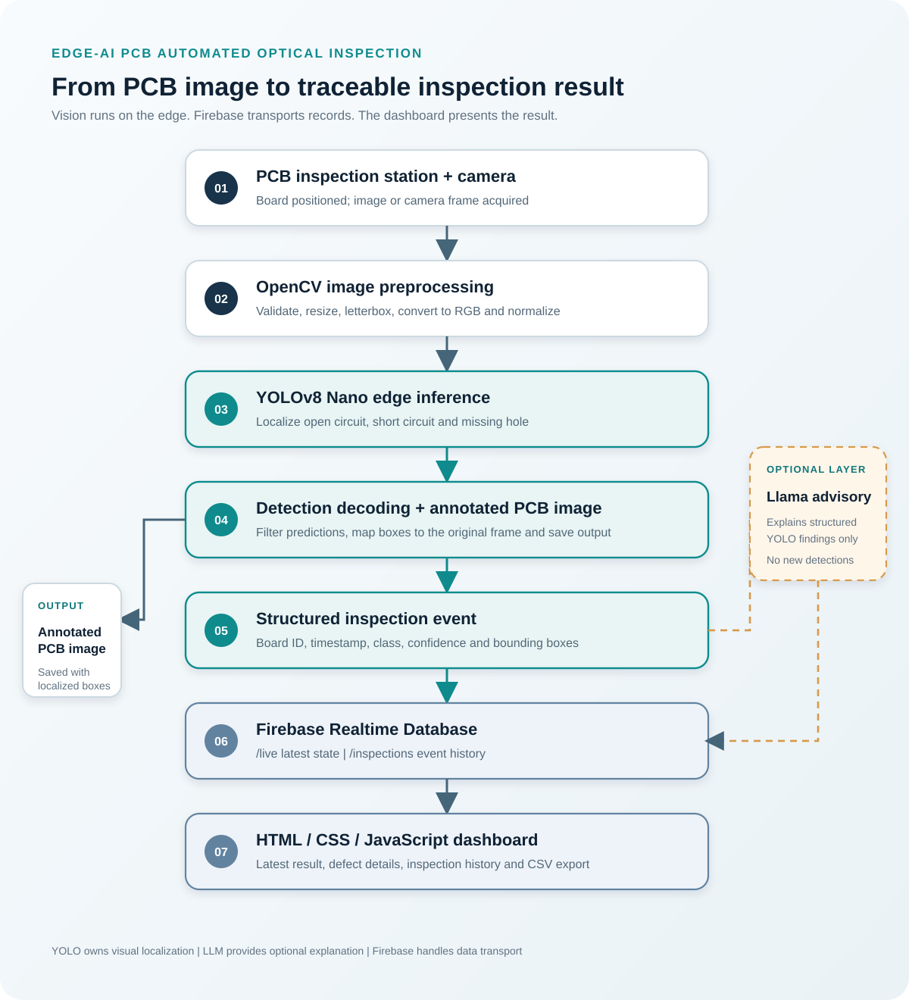

# PCB Automated Optical Inspection - Technical Project Report

**Edge AI | Computer Vision | Raspberry Pi 5 | Firebase | Operator Dashboard**

## Executive summary

We built an edge-oriented PCB inspection workflow to identify three visual defect categories: **open circuit, short circuit and missing hole**. The system flow begins with PCB image acquisition, applies OpenCV preprocessing, runs a YOLOv8 Nano detector, converts localized findings into a structured inspection event and creates an annotated image for review. The event is then published to Firebase Realtime Database and presented through a browser dashboard.

The project brings together the inspection-station workflow with software modules for dataset preparation, detector development, edge inference, event publication, optional operator advisory and inspection-history presentation. YOLO is responsible for visual localization. The optional language-model advisory uses structured detector findings only. Firebase provides data storage and real-time transport.

## 1. End-to-end system flow

The inspection process follows seven stages:

1. **PCB positioning and image acquisition.** A PCB is placed at the inspection position. The edge application accepts an image from a file, a USB/UVC camera or a Raspberry Pi CSI camera through Picamera2.
2. **OpenCV preprocessing.** The captured frame is validated, resized while preserving its aspect ratio, padded to the model input size, converted from BGR to RGB and normalized.
3. **YOLOv8 Nano inference.** The detector predicts candidate bounding boxes and class scores for open circuit, short circuit and missing hole.
4. **Detection decoding and annotation.** Confidence filtering and non-maximum suppression are applied. Bounding boxes are mapped to the original image and drawn on an annotated PCB image.
5. **Inspection-event generation.** The application creates a structured event containing the board ID, timestamp, source, model information, inference latency and list of detections.
6. **Firebase publication and optional advisory.** The edge application publishes the event to Firebase. The optional Llama-family advisory receives structured findings and can produce a short operator explanation.
7. **Dashboard presentation.** The browser dashboard displays the latest inspection state, defect details, inspection history and CSV export.

An empty detection list means that no configured target defect was detected in the supplied image; it is not a guarantee that the entire PCB is defect-free.

## 2. Defect classes and detector output

| Target class | Visual inspection objective | Output |
|---|---|---|
| Open circuit | Locate a visible break or discontinuity in a conductive track | Class, confidence and bounding box |
| Short circuit | Locate an unintended conductive bridge between separate conductive paths | Class, confidence and bounding box |
| Missing hole | Locate an absent or visibly defective hole at an expected board location | Class, confidence and bounding box |

The detector interface includes the class IDs, class names, input dimensions, preprocessing method, output tensor layout, confidence filtering and non-maximum suppression. These details must remain consistent across the training checkpoint, exported model and edge decoder.

## 3. Dataset engineering and model development

The repository includes utilities for supported YOLO, Pascal VOC and DeepPCB annotation inputs. The dataset workflow converts labels into a consistent YOLO format, validates images and bounding boxes, checks duplicates, supports board-aware dataset splits and generates an audit trail. A local OpenCV tool supports project-specific annotation.

Board-aware splitting keeps images or crops from the same physical board or capture group together, reducing data leakage between training and evaluation.

For a reproducible model release, preserve the source dataset and version, annotation mapping, dataset YAML, class list, training arguments, package versions, checkpoint hash, evaluation split, confusion matrix and precision-recall curves.

The training kit and Raspberry Pi handoff specify different class-order conventions. The final class mapping must therefore be verified against the actual checkpoint metadata before pairing weights with an edge decoder. The repository documents this in `pcb_engine_kit/CLASS_ORDER_CONFLICT.md`. Source labels such as `pin_hole` are not automatically treated as `missing_hole` without checking their annotation meaning.

## 4. Raspberry Pi 5 edge deployment

Raspberry Pi 5 is the project's edge-computing platform. The inference application processes a still image or one frame from a USB/UVC or CSI camera using OpenCV and ONNX Runtime CPU execution. It decodes YOLO predictions, maps bounding boxes to the original image, saves an annotated image and serializes the inspection event.

The separate PCB Engine folder-worker uses TensorFlow Lite Runtime to process queued images through incoming, processing, results, archive and failed folders. It writes result JSON and annotated image files. It also includes a reference-board workflow using ORB features and homography alignment to compare configured PCB regions.

Edge performance is assessed on the actual target device using inference latency, throughput, RAM usage, CPU temperature, sustained-run reliability and exported-model parity.

## 5. Reference-board-assisted verification

The reference-board utility compares an inspection image with a known-good board image. It detects ORB features, estimates a homography, aligns the images and evaluates configured regions. Regions with low similarity are returned as review candidates.

These reference-comparison candidates remain distinct from YOLO detections. The two methods provide separate sources of inspection evidence.

## 6. Structured operator advisory

The advisory prompt builder passes selected structured fields such as board ID, class name, confidence and bounding-box coordinates to a Llama-family language-model layer. The advisory can explain an already-detected finding and suggest a human verification step.

The advisory does not inspect the original PCB image, create or relabel detections, suppress model output or independently issue a PASS/REJECT decision. Visual localization remains the responsibility of YOLO.

## 7. Firebase and dashboard

The Raspberry Pi application publishes inspection events directly to Firebase Realtime Database using the Firebase REST interface.

| Database path | Purpose |
|---|---|
| `/live` | Latest inspection state consumed by the dashboard |
| `/inspections/{record_id}` | Individual inspection records and event history |

The static HTML, CSS and JavaScript dashboard subscribes to Firebase updates. It provides an inspection overview, latest board result, defect-category counts, detected-defect details, advisory display, device-status fields, inspection history and CSV export. The dashboard presents inspection information; it does not run the YOLO model.

Firebase Authentication and restrictive Realtime Database rules should be configured. Authentication tokens and private credentials must remain outside browser code and source control.

## 8. Evaluation methodology

Evaluation is organized across detection quality, edge-device behaviour and application-level inspection workflow.

### Detection quality

- Per-class precision and recall.
- mAP@50 and mAP@50-95.
- Confusion matrix.
- Precision-recall curves.
- Visual review of bounding-box localization.
- Evaluation on held-out boards and representative capture conditions.

### Edge-device performance

- Mean, median and p95 inference latency.
- Throughput or frames per second.
- Peak RAM usage.
- CPU temperature under sustained load.
- Sustained-run reliability.
- Prediction parity between the reference and exported model.

### Application and inspection workflow

- Image acquisition and frame validation.
- Correct class-name mapping and bounding-box placement.
- Inspection-event generation and annotated-image saving.
- Firebase publication and dashboard refresh.
- Inspection-history retrieval and CSV export.
- Repeatable PCB positioning and camera alignment at the inspection station.

Report measured values against the exact model artifact, dataset split, runtime, input dimensions and hardware configuration used. Workstation GPU results must be kept separate from Raspberry Pi 5 measurements.

## 9. Repository map

| Folder | Contents |
|---|---|
| `raspberry_pi/` | ONNX Runtime image/camera inference, Firebase REST publisher and runtime requirements |
| `pcb_engine_kit/` | Dataset import, annotation, YOLO training/export, TFLite folder-worker, reference comparison and tests |
| `dashboard/` | Firebase-connected static operator dashboard |
| `llm_advisory/` | Prompt construction and structured advisory boundaries |
| `schemas/` and `firebase/` | Inspection-event schema and example Realtime Database rules |
| `datasets/`, `training/`, `models/` | Dataset source manifest, training guide, release manifest and class-map files |
| `docs/` | Architecture diagram, implementation notes and deployment documentation |
| `demo_video/` | Demonstration-video upload folder and sequence guide |

## 10. Demonstration video

The demonstration video belongs in [`demo_video/`](../demo_video/). The recommended sequence is: inspection station and PCB positioning, camera capture, annotated YOLO output, generated inspection record, Firebase update and corresponding dashboard refresh. Include another board or defect example where available. Use actual system footage and distinguish live results from simulated dashboard scenes.

**GitHub repository:** https://github.com/MathewsV-Manoj/pcb-defect-detection
