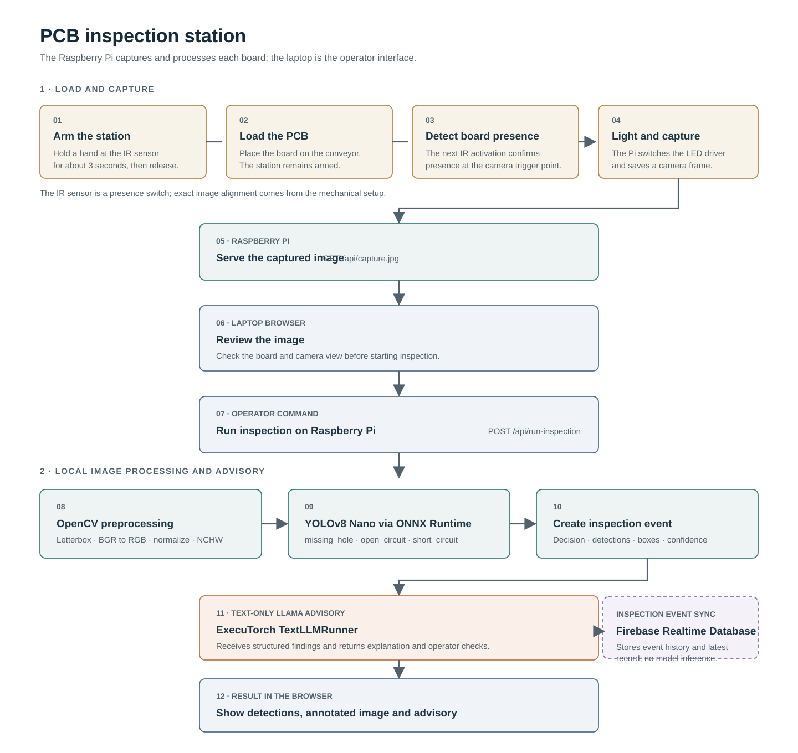

# PCB Automated Optical Inspection
## Technical project report

**Edge AI · Conveyor-based inspection · Raspberry Pi 5 · On-device advisory · Operator interface**

## Executive summary

The project combines a conveyor-based PCB inspection station with an IR presence sensor, camera acquisition and external LED illumination. When a PCB reaches the inspection position, the IR sensor triggers the inspection sequence. The LED strip illuminates the board, the camera captures a frame and the edge pipeline processes the image.

The vision stage uses a YOLOv8 Nano detector interface for three PCB defect categories: open circuit, short circuit and missing hole. Each finding is stored as a structured record containing defect type, severity, image location and confidence. A separate Llama-family advisory pipeline uses ExecuTorch on the Raspberry Pi ARM CPU to explain structured findings, recommend verification actions and generate log text. The operator interface presents the inspection result, advisory and inspection history.

## 1. Physical inspection station

The physical station includes a conveyor assembly, IR presence sensor, camera and external LED strip.

| Element | Role |
|---|---|
| Conveyor | Transports the PCB to the inspection position |
| IR presence sensor | Detects board arrival and initiates the capture sequence |
| External LED strip | Provides illumination during image acquisition |
| Camera | Captures the illuminated PCB image |
| Raspberry Pi 5 | Runs the station controller and edge software |

The Raspberry Pi station controller reads the IR sensor through a configurable GPIO input and switches the external illumination driver through a separate GPIO output. The LED strip is powered through its external driver, not directly from a Pi GPIO pin. GPIO numbers and input/output polarity are installation-configured rather than assumed in source code.

## 2. Reference architecture

### End-to-end sequence

1. The conveyor moves the PCB to the inspection zone.
2. The IR sensor detects board arrival.
3. The external LED strip illuminates the PCB.
4. The camera acquires a frame after the configured illumination-settle interval.
5. OpenCV validates and preprocesses the image.
6. YOLOv8 Nano detects and localizes configured defects.
7. The edge application creates an annotated image and structured inspection event.
8. The inspection coordinator passes only structured findings to the Llama/ExecuTorch advisory pipeline.
9. The advisory is appended to the event; the completed record can be synchronized to Firebase.
10. The operator interface displays the alert, advice and inspection log.

### Separate inference pipelines

| Vision pipeline | Advisory pipeline |
|---|---|
| YOLOv8 Nano | Llama 3.2 Instruct 1B or 3B |
| OpenCV preprocessing | Structured text prompt |
| ONNX Runtime on Raspberry Pi 5 ARM CPU in the current source implementation | ExecuTorch on Raspberry Pi 5 ARM CPU |
| Predicts defect class and location | Explains findings, recommends verification actions and writes log text |
| HailoRT on a Hailo NPU / AI HAT+ / AI HAT+ 2 is an optional committee-listed vision route; no Hailo integration is included in this source checkout | Remains separate from the vision runtime |

The Hailo accelerator is an optional architecture path for vision only. The implemented vision path in this source checkout uses ONNX Runtime on the Pi CPU. Hailo does not replace or execute the Llama advisory pipeline.

## 3. Vision detection and defect classes

The detector output is localized rather than a single image-level label.

| Class ID | Defect type | Inspection meaning |
|---:|---|---|
| 0 | missing_hole | Expected PCB hole absent or visibly defective |
| 1 | open_circuit | Visible discontinuity in a conductive track |
| 2 | short_circuit | Unintended conductive bridge between separate tracks |

The model interface includes the class-ID map, input dimensions, color order, normalization, output tensor layout, confidence threshold and non-maximum suppression. The same mapping is used in the Pi inference path, dataset converter, export utility and TFLite worker.

## 4. Structured defect record

Each inspection event includes a record ID, board ID, timestamp, source, model identity, inference latency and an array of detector findings.

Each finding carries four independent fields:

| Field | Meaning |
|---|---|
| Type | Detected PCB defect class |
| Severity | LOW, MEDIUM, HIGH or UNASSESSED |
| Location | Image-coordinate bounding box and normalized centre |
| Confidence | Vision model confidence score |

Severity is not inferred from confidence. It is assigned using defect type, physical extent and position within the board's functional layout. Where a board-specific severity policy has not established an impact level, the event retains UNASSESSED for operator review.

The machine-readable contract and example are stored in `schemas/inspection-event.schema.json` and `schemas/example-event.json`.

## 5. Llama advisory and ExecuTorch

The advisory is a separate on-device reasoning stage. A pretrained Llama 3.2 Instruct 1B or 3B model is the reference model family, with ExecuTorch as the on-device runtime on the Raspberry Pi ARM CPU. Fine-tuning is not a prerequisite for the structured prompt workflow.

The advisory receives defect type, severity, location, confidence, board ID and timestamp. It generates a concise explanation, recommended verification actions and a structured log entry. It does not receive raw PCB pixels, detect or classify defects, modify detector findings, infer severity from confidence or independently issue a PASS/REJECT decision.

The source implementation comprises:
- `llm_advisory/prompt.py` — builds a text-only prompt from structured findings.
- `llm_advisory/run_executorch.py` — invokes the ExecuTorch LLM runner and captures advisory response telemetry.
- `raspberry_pi/run_inspection.py` — sequences vision, advisory, local event update and optional Firebase publication.

The LLM Runner Python bindings are experimental and depend on the ExecuTorch build. The .pte model and matching tokenizer binary are separate deployment assets and are not included in this source checkout. The source runner is present; target-device execution requires the matching runtime build and model assets.

## 6. Operator interface and data layer

The operator interface displays the inspection result, defect type, severity, location, confidence, advisory response and inspection history. The HTML dashboard is in `dashboard/index.html`.

Firebase Realtime Database provides record synchronization:
- `/live` — latest station and inspection state.
- `/inspections/{record_id}` — retained inspection events.

Image preprocessing, vision inference and advisory reasoning are designed to execute on the edge device. Firebase is a data layer, not an inference runtime.

## 7. Technology stack

| Layer | Technology |
|---|---|
| Physical inspection | Conveyor, IR presence sensor, camera, external LED strip |
| Edge computer | Raspberry Pi 5 |
| Image processing | OpenCV |
| Vision detection | YOLOv8 Nano |
| Base vision runtime | ONNX Runtime CPU |
| Optional vision acceleration | Hailo NPU, HailoRT, AI HAT+ / AI HAT+ 2 |
| Advisory model | Llama 3.2 Instruct family |
| Advisory runtime | ExecuTorch on Raspberry Pi ARM CPU |
| Operator interface | HTML, CSS and JavaScript |
| Record synchronization | Firebase Realtime Database |
| Data contract | JSON Schema |

## 8. Dataset strategy

The committee reference lists MVTec AD, NEU Surface Defect and KolektorSDD as industrial anomaly or surface-defect datasets. They are not direct substitutes for the PCB target labels: NEU concerns steel-surface defects, while KolektorSDD concerns electrical commutators. PCB-specific references include DeepPCB and Tiny-Defect-Detection-for-PCB, together with project camera captures.

Dataset identity, licence/terms, class mapping and split provenance are recorded in `datasets/SOURCE_MANIFEST.csv`. A source is only described as training data when its use is confirmed by the exact training configuration. The full processed dataset archive is not included in this source checkout.

## 9. Evaluation framework

| Area | Evaluation evidence |
|---|---|
| Detection quality | Per-class precision, recall, F1, confusion matrix, false alarms and missed defects |
| Real-time vision | FPS, per-image latency, end-to-end latency, memory and power on Raspberry Pi 5 |
| Llama runtime | Time to first token, tokens per second, total response time and peak memory |
| Advice quality | Relevance to type, severity and location; useful, grounded actions |
| Operator experience | Alert clarity, review flow and traceable inspection history |
| Runtime separation | Independent vision and ExecuTorch advisory execution; optional Hailo vision route documented separately |

Performance values are reported only when tied to the exact dataset split, checkpoint, runtime and target hardware. The source checkout does not contain the final trained three-class detector binary, complete processed dataset archive, ExecuTorch model/tokenizer assets or validated Raspberry Pi 5 benchmark report. No detection or device-performance figures are claimed without those measurements.

## 10. Repository structure

- `raspberry_pi/` — IR-triggered station controller, inspection coordinator, vision inference and Firebase event publishing.
- `llm_advisory/` — structured prompt builder and text-only ExecuTorch runner.
- `dashboard/` — operator interface.
- `schemas/` — structured event schema and example.
- `models/` — class map and model release manifest.
- `datasets/` — dataset provenance manifest.
- `pcb_engine_kit/` — supplementary dataset, annotation and training/export utilities.
- `tests/` — advisory, schema, architecture, dashboard and file-handling contract tests.
- `docs/` — architecture and deployment documentation.
- `demo_video/` — demonstration scope for the physical inspection station.

The demonstration video is a separate submission media asset and is not embedded in this source checkout.

**Repository:** https://github.com/MathewsV-Manoj/pcb-defect-detection
