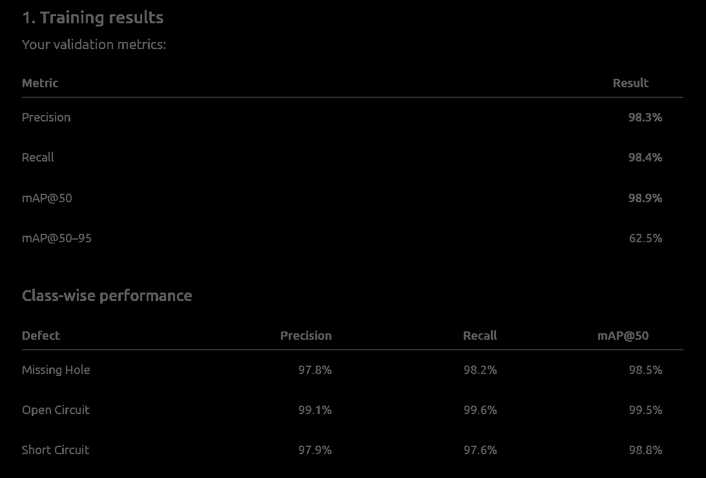

# Project PCB detector validation results

**Result type:** Team-supplied screenshot transcription; not independently reproduced  
**Evaluation split shown/reported:** Validation  
**Source filename:** image(20261122-041729).png  
**Original source-image SHA-256:** e3e0bcf601d66d29163757287bf646ec18d6967ebc594688a169893c8cb02b0c  
**Original dimensions:** 1093 × 740 pixels  
**Archived image:** project-validation-screenshot.png  
**Machine-readable record:** project_validation_metrics.json

## Values visible in the supplied screenshot

| Metric | Reported value |
|---|---:|
| Precision | 98.3% |
| Recall | 98.4% |
| mAP@0.50 | 98.9% |
| mAP@0.50:0.95 | 62.5% |

| Defect class | Precision | Recall | mAP@0.50 |
|---|---:|---:|---:|
| Missing hole | 97.8% | 98.2% | 98.5% |
| Open circuit | 99.1% | 99.6% | 99.5% |
| Short circuit | 97.9% | 97.6% | 98.8% |

## Provenance not visible in the screenshot

The screenshot does not identify the model checkpoint path or SHA-256, training-provenance sidecar, dataset name/version, import-manifest hash, group-level split manifest, validation image/object counts, image size, confidence threshold, NMS IoU threshold, evaluator version or raw evaluation output.

The repository currently has no primary three-class fault-detector checkpoint, processed dataset or completed provenance audit. The later-supplied `PCB_ENGINE_KIT(2).zip` contains a separate ResAttention U-Net checkpoint for five-channel trace-mask extraction, not the three-class RGB defect detector. That archive contains no training dataset, training log, checkpoint provenance or validation metrics for the U-Net. Its SHA-256 integrity check is recorded in `supplied_model_package_audit.json`. As a result:

- these values remain **team-supplied screenshot-reported validation metrics**;
- they are not independently reproduced by the current repository scripts;
- they cannot yet be associated with the random-initialization training workflow introduced in the latest code;
- they are not held-out test metrics or target-device performance;
- they must not be replaced with numbers from other authors' PCB models or device benchmarks.

## Required reconciliation

Before these values can be treated as reproducible project results, recover the exact original checkpoint, training run and dataset that produced this screenshot. Compute and preserve their hashes, reconstruct the split manifest, and retain the raw evaluator output. If the exact model or source data cannot be recovered, keep this record as an unverified historical report and produce a new result using the current audited pipeline.

Run a separate held-out board-group test before claiming test performance. Do not reuse validation boards as test boards.

## File hashes

- Original screenshot SHA-256: e3e0bcf601d66d29163757287bf646ec18d6967ebc594688a169893c8cb02b0c
- Archived repository image SHA-256: 8fddc32aeb9565bc8e2598885a1c88268a29eb2f18c9ab07b2bfc529430219b9

No numerical metrics from other PCB detectors, papers, hardware benchmarks or Llama deployments are included in the project-results record.
